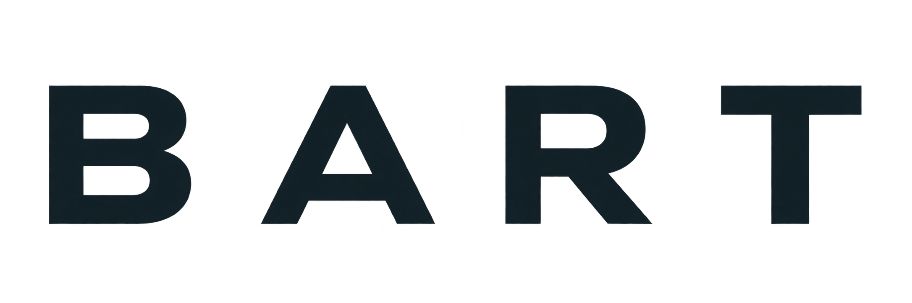

# BART wordmark

Squared bowls give the lettering weight. The A counter and R leg echo the mark's diagonal. Preserve uppercase BART. Review the optical gap of each pair and the shape of the A counter before narrowing or shrinking the artwork.

For a horizontal lockup, place the icon left of the lettering and align the optical centers. Start with a visible icon height of about 1.2× the visible letter height and a gap of about 0.35× letter height. Use these as review targets. Compare at 120 px and 160 px lettering widths on a light panel before approving a minimum size.

Use the full product name as nearby HTML or Markdown text in first-contact surfaces. For wordmark-only artwork, use BART as its text alternative.

[Naming](../02-naming/naming.md) · [Application plan](../07-applications/applications.md)
