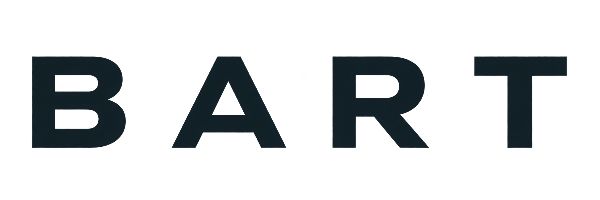

# BART Brand Identity

**Blender-Agent Refinement Toolkit** is the product. **BART** is the agent. **Give shape to an idea.** is the slogan recorded in the [rebrand decision](https://github.com/vixttha/Blender-Agent-Refinement-Toolkit/issues/62).

## Facet

The mark pairs a dark mesh plane with a mint facet, separated by a diagonal break. The BART wordmark repeats the angle in its A counter and R leg. This draft uses the same idea at two scales: the symbol for recognition and the full lettering when readers need the name.

| Logo symbol | BART wordmark |
| --- | --- |
|  |  |

The preview assets are designed for a light background. See the [application plan](07-applications/applications.md) for dark surfaces and small sizes.

- [Audience and art direction](01-strategy/brief.md)
- [Name and usage](02-naming/naming.md)
- [Slogan and voice](03-messaging/voice.md)
- [Logo usage](04-logo/logo.md)
- [Wordmark usage](05-wordmark/wordmark.md)
- [Color, type, and imagery](06-visual-system/system.md)
- [Review and decisions](08-review/review.md)
- [Downloads and image provenance](09-assets/README.md)
